<p align="center">
  
</p>

<p align="center">
  <a href="https://github.com/ishandutta2007/Awesome-Awesome-Awesome"></a>
  <a href="https://discord.gg/jc4xtF58Ve"></a>
  <a href="https://github.com/ishandutta2007/Awesome-Procurement-Service-Management/stargazers"></a>
  <a href="https://github.com/ishandutta2007/Awesome-Procurement-Service-Management/network/members"></a>
  <a href="https://github.com/ishandutta2007/Awesome-Procurement-Service-Management/blob/main/LICENSE"></a>
  <a href="https://github.com/ishandutta2007/Awesome-Procurement-Service-Management/pulls"></a>
  <a href="https://github.com/ishandutta2007"></a>
</p>

---

# 🚀 Awesome Procurement Service Management (PSM)

> **A definitive, SEO-optimized directory of enterprise SaaS solutions, AI-driven intake-to-pay orchestration tools, and sovereign open-source e-procurement platforms.**

Welcome to the **Awesome Procurement Service Management (PSM)** repository! In modern digital enterprises, procurement has transitioned from manual purchase orders and fragmented emails into intelligent **Intake-to-Pay (I2P)**, **Procure-to-Pay (P2P)**, and **Source-to-Pay (S2P)** workflows.

This curated landscape covers both market-leading enterprise suites (ServiceNow ShoppingHub, SAP Ariba, Coupa, Zip) and flexible open-source architectures (ERPNext, Apache OFBiz, BidMaster-Pro) designed to automate procurement help desks, enforce corporate compliance policies, streamline vendor relationship management (VRM/SRM), and orchestrate three-way invoice matching.

---

## 📑 Table of Contents

- [📊 Sector Overview & Market Dynamics](#-sector-overview--market-dynamics)
- [🏢 SaaS & Hosted Platforms](#-saas--hosted-platforms)
- [💻 Open-Source GitHub Projects](#-open-source-github-projects)
- [🏗️ Self-Hosted Architecture Blueprint](#-self-hosted-architecture-blueprint)
- [🤝 How to Contribute](#-how-to-contribute)
- [💖 Support & Community](#-support--community)
- [📈 Star History](#-star-history)
- [⚖️ Disclaimer & Compliance](#️-disclaimer--compliance)

---

## 📊 Sector Overview & Market Dynamics

The global **Procurement Software & Procurement Service Management (PSM)** market is valued at approximately **$7.5 billion to $8.9 billion in 2025–2026** and is projected to expand at a compound annual growth rate (**CAGR of 10.4%–12.1%**) to surpass **$16.5 billion by 2032**.

The sector exhibits **moderate fragmentation rather than a winner-take-all monopoly**:
- **Enterprise Core Systems**: Large-scale ERP titans such as **SAP Ariba**, **ServiceNow**, and **Coupa** dominate back-office transaction accounting, global multi-entity compliance, and complex direct-materials supply chains.
- **Intake-to-Pay Challengers**: Fast-scaling orchestration specialists such as **Zip**, **Airbase**, and **Procurify** capture modern front-door employee experiences, utilizing generative AI assistants, Slack/Teams approval integrations, and lightweight vendor onboarding.
- **Sovereign Open Source**: Engineering teams increasingly adopt open frameworks (ERPNext, microservice P2P stacks, and MCP protocol agents) to circumvent seat-based pricing and maintain data sovereignty.

---

## 🏢 SaaS & Hosted Platforms

The table below compiles leading commercial Procurement Service Management and Procure-to-Pay platforms, ranked in descending order by company scale (market capitalization, private valuation, or acquisition size).

| 🏢 Platform / Solution | 📈 Company Scale (Valuation / Revenue) | 🎯 Core Capabilities & Focus | 💳 Specific Starting Tier Price | 🎁 Free Tier / Trial Limit |
| :--- | :--- | :--- | :--- | :--- |
| **[SAP Ariba](https://www.sap.com/products/spend-management/procurement.html)** | **$250B+ Market Cap**<br>*(Parent: SAP SE; ~$35B ARR)* | Enterprise Source-to-Pay suite, Joule AI assistant, Ariba Network supplier collaboration, global multi-currency compliance. | **Free for suppliers**;<br>Buyer enterprise starts at **$20,000/year** (~$1,666/month base fee). | **Perpetual Free Plan for Suppliers** (Standard Account: unlimited basic POs and e-invoices up to $50k transaction value or 4 documents); 30-day guided interactive buyer sandbox tour. |
| **[ServiceNow PSM](https://www.servicenow.com/products/procurement-service-management.html)** | **$185B Market Cap**<br>*(~$10B ARR)* | ShoppingHub intake portal, virtual agent inquiry deflection, Now Platform cross-department orchestration, ERP sync. | Base enterprise contracts start at **$35,000/year** (~$2,916/month; ~$100/licensed fulfiller seat/month). | **15-Day Personal Developer Instance** via ServiceNow Developer Program (full administrative platform sandbox with 1 active developer instance); 30-day enterprise POC sandbox on qualification. |
| **[Tipalti](https://tipalti.com/)** | **$8.3B Valuation**<br>*(~$200M+ ARR; Series F)* | Global AP automation, multi-subsidiary procurement controls, 2-minute line-item OCR capture, 120+ currency payouts. | **$99/month** (*Select* AP automation base plan; Mass Payments tier at **$249/month**) + $0.50–$2.00 per transaction fee. | **14-Day Test Environment Sandbox** (simulated testing environment with up to 100 sample vendor transactions and invoice approvals). |
| **[Coupa](https://www.coupa.com/)** | **$8.0B Valuation**<br>*(~$860M ARR; Thoma Bravo)* | Total spend management, $8T+ community intelligence, AI-guided buying for direct/indirect spend, fraud detection. | Core mid-market P2P packages start at **$2,500/month** (**$30,000/year** billed annually). | **14-Day Guided Proof-of-Concept Trial** (hands-on sandboxed environment with pre-populated spend catalogs and approval chains upon sales qualification). |
| **[Zip](https://zip.com/)** | **$2.2B Valuation**<br>*(~$60M+ ARR; Series D)* | Modern intake-to-pay orchestration, automated cross-functional routing (Legal/Security/IT), central spend dashboard. | Minimum entry contracts start at **$40,000/year** (~$3,333/month for pilot tiers up to 100 users). | **14-Day Interactive Guided Sandbox** (pilot sandbox environment pre-loaded with customizable intake request templates and Slack notifications). |
| **[GEP SMART](https://www.gep.com/software/gep-smart)** | **$2.0B Valuation**<br>*(~$300M ARR; Private)* | Unified AI-driven S2P software, RFx e-auctions, contract risk modeling, automated supplier performance scoring. | Modular procurement tools start at **$25,000/year** (~$2,083/month per core functional module). | **30-Day Enterprise Evaluation Sandbox** (dedicated sandbox with sample sourcing event templates and supplier scorecard models). |
| **[Jaggaer](https://www.jaggaer.com/)** | **$1.5B Valuation**<br>*(~$250M ARR; Francisco Partners)* | Autonomous procurement orchestration, 1,000+ pre-built ERP connectors, ISO 42001 certified AI spend management. | Spend & supplier modules start at **$20,000/year** (~$1,666/month base subscription). | **30-Day Enterprise Sandbox** (evaluation environment with pre-configured SAP/Oracle integration test beds and supplier portal demo). |
| **[Ivalua](https://www.ivalua.com/)** | **$1.0B+ Valuation**<br>*(~$180M ARR; Unicorn)* | Highly configurable cloud Source-to-Pay platform, advanced eRFX support, direct materials procurement and analytics. | Single-process modular suites start at **$25,000/year** (~$2,083/month). | **30-Day Guided Interactive Demo Sandbox** (cloud sandbox pre-loaded with sample direct/indirect material RFQs and supplier contracts). |
| **[Airbase](https://www.airbase.com/)** | **$325M Acquisition**<br>*(Parent: Paylocity; ~$40M ARR)* | Mid-market procure-to-pay, corporate card issuance, automated AP invoice matching, and employee expense reporting. | **$299/month** (*Essentials* tier for up to 20 users; billed annually at $3,588/year). | **14-Day Proof-of-Concept Sandbox** (full access up to 20 users and maximum 25 simulated expense/intake approval submissions). |
| **[Procurify](https://www.procurify.com/)** | **$250M Valuation**<br>*(~$30M ARR; Series C)* | Agentic procurement platform, PunchOut supplier catalogs, automated 3-way matching, and real-time budget tracking. | **$1,000/month** (*Pioneer* tier for up to 25 users; billed annually at $12,000/year). | **14-Day Full-Access Free Trial** (complete feature access for up to 10 user seats and up to 50 purchase orders). |

---

## 💻 Open-Source GitHub Projects

Explore verified open-source repositories for self-hosted procurement automation, tendering, supplier evaluation, and AI-assisted source-to-pay workflows.

> **Sorted in descending order by GitHub Star count.** Click the star badge beside any repository to inspect its stargazers.

| # | 📦 Repository & Project | ⭐ GitHub Stars Badge | 🛠️ Tech Stack | 💡 Focus & Key Capabilities |
| :-: | :--- | :--- | :--- | :--- |
| **1** | **[ERPNext (Buying & Procurement)](https://github.com/frappe/erpnext)** | [](https://github.com/frappe/erpnext/stargazers) | Python, Frappe, MariaDB, JS | Full-featured enterprise open-source ERP with an end-to-end purchasing module: Material Requests, Supplier Quotations, Purchase Orders, Automatic Reorder Levels, and 3-Way Matching. |
| **2** | **[Apache OFBiz](https://github.com/apache/ofbiz-framework)** | [](https://github.com/apache/ofbiz-framework/stargazers) | Java, Gradle, Groovy | Mature enterprise suite providing comprehensive B2B order management, supplier agreements, purchasing agreements, inventory replenishment, and accounting integration. |
| **3** | **[BidMaster-Pro](https://github.com/guangshu100/BidMaster-Pro)** | [](https://github.com/guangshu100/BidMaster-Pro/stargazers) | Python, Vue, RAG, OCR | End-to-end AI agent for procurement tendering: automated tender notice parsing, 21 automated compliance verification checks, bid generation, and multi-model LLM document structuring. |
| **4** | **[leihs](https://github.com/leihs/leihs)** | [](https://github.com/leihs/leihs/stargazers) | Ruby on Rails, Clojure, PostgreSQL | Production-tested web application for internal enterprise inventory management, asset reservation, equipment lending, and departmental procurement logistics. |
| **5** | **[OpenProcurement API](https://github.com/openprocurement/openprocurement.api)** | [](https://github.com/openprocurement/openprocurement.api/stargazers) | Python, Pyramid, CouchDB | High-performance core API datastore engine built for transparent public e-procurement systems; adheres strictly to the Open Contracting Data Standard (OCDS). |
| **6** | **[Buyer Eval Skill](https://github.com/salespeak-ai/buyer-eval-skill)** | [](https://github.com/salespeak-ai/buyer-eval-skill/stargazers) | Python, Claude Code Skill | B2B software vendor procurement evaluation skill designed for Claude Code: executes domain-expert RFQ queries, conducts vendor AI agent conversations, and generates evidence-based scorecards. |
| **7** | **[MatchFlow Invoice Processor](https://github.com/datpham0412/invoice-processor)** | [](https://github.com/datpham0412/invoice-processor/stargazers) | .NET 6, React, Azure Form OCR | Clean Architecture full-stack automated invoice processing system featuring AI OCR extraction, purchase-order matching, validation gates, and one-command Docker Compose setup. |
| **8** | **[AI Procurement Assistant](https://github.com/AmirLayegh/procurement-ai-assistant)** | [](https://github.com/AmirLayegh/procurement-ai-assistant/stargazers) | Python, Superlinked, FastAPI | Natural language semantic search assistant for retail buyers and purchasing officers; enables natural query matching across multi-attribute catalog inventories. |
| **9** | **[Federal Contracting MCPs](https://github.com/1102tools-dev/federal-contracting-mcps)** | [](https://github.com/1102tools-dev/federal-contracting-mcps/stargazers) | Python, MCP, JSON | Model Context Protocol servers connecting LLM agents (Claude, ChatGPT) directly to SAM.gov, USAspending, GSA CALC+, and Federal Acquisition Regulation (FAR) databases. |
| **10** | **[e-procure](https://github.com/Gichure/e-procure)** | [](https://github.com/Gichure/e-procure/stargazers) | Java, Spring Boot, Camunda, Kafka | Microservices e-procurement suite automating requisitions, PO lifecycle, vendor bidding, and payment processing with Camunda BPMN workflow orchestration and Keycloak SSO. |
| **11** | **[VendSync (BidFlow)](https://github.com/RavalMunjal/VendSync)** | [](https://github.com/RavalMunjal/VendSync/stargazers) | React, Node.js, Express, MongoDB | Full-stack procurement & vendor management ERP covering RFQ creation, vendor portal quotation submission, lowest-price side-by-side analysis, and automatic PO/invoice generation. |
| **12** | **[mcp-procurement](https://github.com/zavora-ai/mcp-procurement)** | [](https://github.com/zavora-ai/mcp-procurement/stargazers) | TypeScript, Node.js, MCP Protocol | AI-native procurement agent engine exposing 37 MCP tools across source-to-pay: supplier risk analysis, price benchmarking, three-way invoice matching, and approval gating. |
| **13** | **[OpenTradeIntel](https://github.com/b2baitrade-ui/opentradeintel)** | [](https://github.com/b2baitrade-ui/opentradeintel/stargazers) | Python, FastAPI, CLI, TED API | Sovereign procurement and B2B sourcing intelligence engine; indexes EU public procurement notices via TED API and computes deterministic 0–100 supplier compatibility scores. |

---

## 🏗️ Self-Hosted Architecture Blueprint

For organizations designing a self-hosted, sovereign procurement operations stack without seat-licensing restrictions, consider combining the following architectural tiers:

```
┌────────────────────────────────────────────────────────┐
│   Employee Front-Door & Conversational Intake Layer   │
│   (Slack/Teams Bot + Claude/GPT with MCP Protocol)     │
└──────────────────────────┬─────────────────────────────┘
                           │
                           ▼
┌────────────────────────────────────────────────────────┐
│     Procurement Orchestration & Workflow Engine       │
│     (VendSync / e-procure Camunda BPMN Engine)         │
└──────────────┬───────────────────────────┬─────────────┘
               │                           │
               ▼                           ▼
┌─────────────────────────────┐ ┌────────────────────────┐
│  Vendor & Sourcing Portal   │ │ AI Compliance & Audit  │
│  (Quotation & RFQ Modules)  │ │ (BidMaster / MatchFlow)│
└──────────────┬──────────────┘ └──────────┬─────────────┘
               │                           │
               ▼                           ▼
┌────────────────────────────────────────────────────────┐
│           Core ERP Ledger & 3-Way Match Layer          │
│       (ERPNext / Apache OFBiz / Existing Finance)      │
└────────────────────────────────────────────────────────┘
```

---

## 🤝 How to Contribute

We welcome additions, corrections, and updates from the procurement and open-source community!

1. 🍴 **Fork** this repository.
2. 🌿 Create a descriptive feature branch: `git checkout -b add-new-psm-tool`.
3. 📝 Update `README.md` following the established table formats:
   - Provide verified, non-generic starting tier pricing.
   - Specify exact free tier or free trial limits.
   - Include the GitHub star badge linking to the stargazers page.
4. 🧪 Verify that all markdown links and SVG assets render cleanly.
5. 🚀 Submit a **Pull Request** with a concise description of your additions.

---

## 💖 Support & Community

Thank you for exploring this curated repository! If you find this guide to Procurement Service Management, Intake-to-Pay, and P2P solutions valuable:

- ⭐ **Star** this repository to stay updated on new tools and ecosystem developments.
- 🍴 **Fork** and contribute your discoveries or open-source projects via pull request.
- 📢 **Share** this list with procurement teams, engineering leaders, and finance operations professionals.
- ☕ **Sponsor**: If you would like to support the ongoing research and maintenance of this and related awesome lists, consider buying a coffee via the [GitHub Sponsor Dashboard](https://github.com/sponsors/ishandutta2007).

---

## 📈 Star History

[](https://star-history.dera.page/#ishandutta2007/Awesome-Procurement-Service-Management&type=date&legend=top-left)

---

## ⚖️ Disclaimer & Compliance

- This list is **community-curated** for educational, architectural, and informational purposes. Mention of commercial products does not constitute an endorsement.
- Procurement systems handle sensitive vendor pricing, banking credentials, and regulatory filings. Organizations must adhere to applicable public procurement laws, Sarbanes-Oxley (SOX), GDPR, and anti-corruption frameworks.
- Verify license terms when evaluating open-source projects for commercial or production deployment.

---

<p align="center">
  <b>Curated with ❤️ by <a href="https://github.com/ishandutta2007">Ishan Dutta</a> and the Global Open-Source Community.</b><br>
  Explore more curated knowledge bases at <a href="https://github.com/ishandutta2007/Awesome-Awesome-Awesome">Awesome-Awesome-Awesome</a>.
</p>
